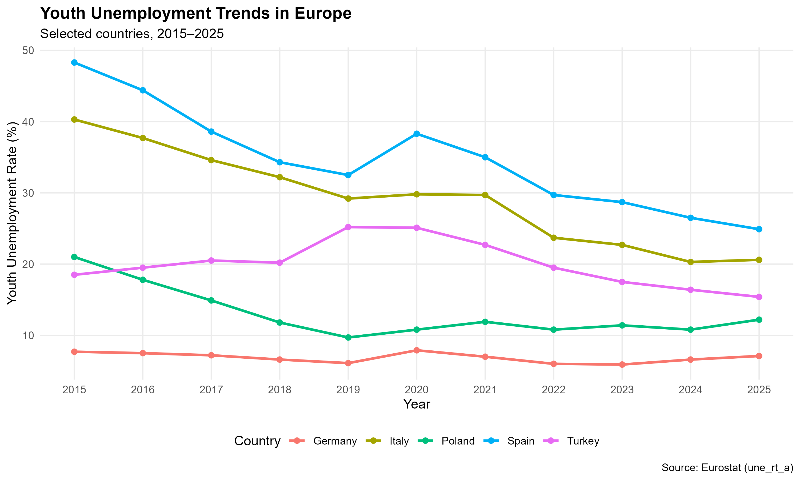
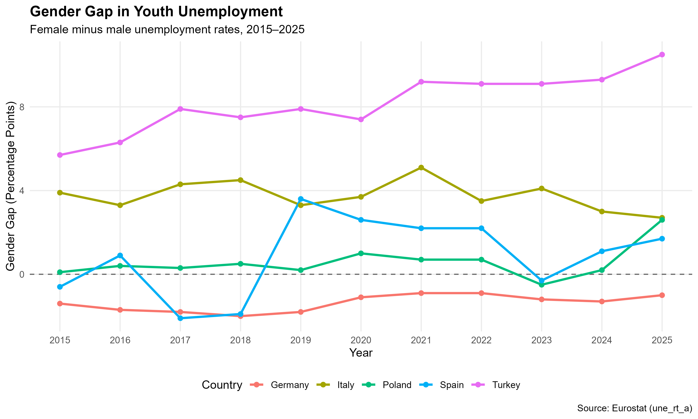

# European Youth Unemployment Analysis

**Hamit Kaan Parlak | R project | November 2026**

[Read the report](https://cellocukurabiye.github.io/European-Youth-Unemployment-Analysis/) · [View the R script](analysis.R)

## Overview

This project compares youth unemployment rates in Germany, Spain, Italy, Poland, and Turkey between 2015 and 2025. I used annual Eurostat data for people aged 15–24 to examine changes over time and differences between women and men.

The dataset contains **165 country-year-gender records**: five countries, eleven years, and three categories (female, male, and total).

## What I did

- Collected and cleaned Eurostat data using R.
- Calculated country-level descriptive statistics and annual female–male unemployment gaps.
- Created two line charts to compare trends.
- Checked missing values, duplicates, and Eurostat quality flags.
- Prepared an HTML report with Quarto.

The gender gap is calculated as **female unemployment rate − male unemployment rate** (percentage points). A positive gap means the rate is higher among women.

## Main findings

Spain and Italy had the largest decreases in overall youth unemployment between 2015 and 2025: **23.4** and **19.7 percentage points**, respectively.

Turkey's overall youth unemployment rate fell from **18.5% to 15.4%**, but its female–male gap increased from **5.7 to 10.5 percentage points**. This is a descriptive comparison, not evidence of a causal relationship.





## Data notes

**Source:** Eurostat, [Unemployment by sex and age – annual data (`une_rt_a`)](https://doi.org/10.2908/une_rt_a). Data accessed: **8 November 2026**.

The dataset has no missing unemployment rates for the selected country-year-gender combinations. Eurostat marks 12 records with a time-series break (`b`) and 15 records with a definition difference (`d`), mainly affecting comparisons across particular years. These records were retained and the flags are discussed in the report.

The analysis uses simple averages of annual country rates, not population-weighted averages across the full period. It does not include hypothesis tests or causal modelling.

## Files

- [`analysis.R`](analysis.R): data preparation, analysis, charts, and quality checks
- [`research_report.qmd`](research_report.qmd): Quarto report source
- [`index.html`](index.html): published HTML report
- [`data/`](data/): cleaned dataset
- [`results/`](results/): tables, charts, and quality flag summary

## Running the analysis

1. Install R and RStudio.
2. Install the required packages once:
   ```r
   install.packages(c("eurostat", "dplyr", "ggplot2", "readr", "tidyr"))
   ```
3. Open the project folder in RStudio and run `analysis.R` from top to bottom. This downloads the current Eurostat dataset and recreates the files in `data/` and `results/`.
4. Open `research_report.qmd` and click **Render** to generate the HTML report (Quarto must be installed).

**Reproducibility note:** Eurostat data may be revised after the original download. The CSV files in this repository reflect the analysis shared in November 2026; rerunning the script later may produce different values.

## Author

**Hamit Kaan Parlak**  
Statistics student, Ondokuz Mayis University  
Minor in Industrial Engineering
