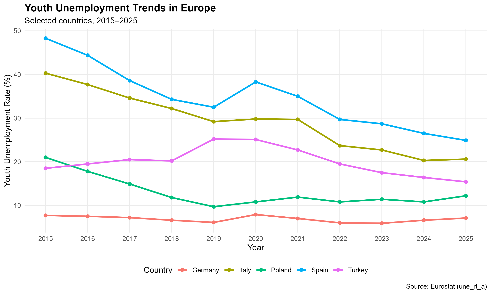
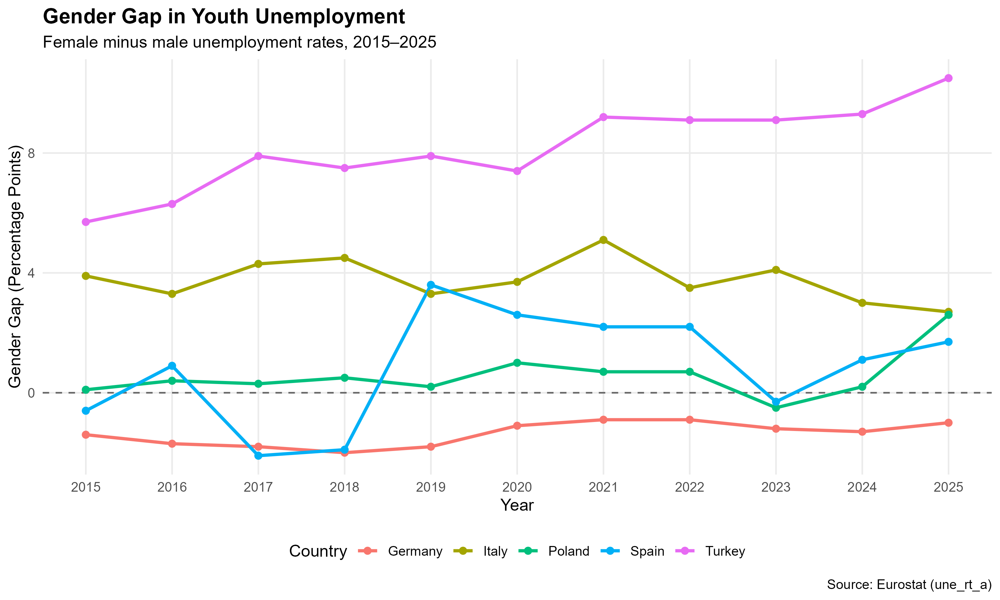

# Introduction

Youth unemployment is an important socioeconomic indicator that reflects labor market challenges faced by young people.

This study examines youth unemployment rates in Germany, Spain, Italy, Poland, and Turkey between 2015 and 2025.

The analysis focuses on overall unemployment trends and differences between female and male youth unemployment rates.

# Data and Methodology

The dataset was obtained from Eurostat (dataset code: `une_rt_a`).

The analysis covers individuals aged 15–24 years and uses annual unemployment rates expressed as percentages of the corresponding labor force.

Data cleaning, descriptive statistical analysis, and visualization were performed using R.

```{r}
library(readr)
library(dplyr)
library(ggplot2)

data <- read_csv(
  "data/youth_unemployment_clean_2015_2025.csv",
  show_col_types = FALSE
)
```

# Descriptive Statistics

The following table summarizes youth unemployment rates in the five selected countries.

```{r}
country_summary <- read_csv(
  "results/country_summary.csv",
  show_col_types = FALSE
)

knitr::kable(
  country_summary,
  caption = "Descriptive statistics of youth unemployment rates"
)
```

# Youth Unemployment Trends

The following figure illustrates changes in youth unemployment rates between 2015 and 2025.

```{r, out.width="100%"}

```
# Gender Differences in Youth Unemployment

This section compares youth unemployment rates between women and men in five countries.

The gender gap is calculated by subtracting the male unemployment rate from the female unemployment rate.

A positive value means that the female unemployment rate is higher. A negative value means that the male unemployment rate is higher.

## Average Gender Gaps

The table below shows the average unemployment rates for young women and men between 2015 and 2025.

```{r}
gender_summary <- readr::read_csv(
  "results/gender_summary.csv",
  show_col_types = FALSE
)

knitr::kable(
  gender_summary %>%
    select(country, mean_female, mean_male, mean_gap),
  col.names = c(
    "Country",
    "Female (%)",
    "Male (%)",
    "Gender Gap (pp)"
  ),
  digits = 2,
  caption = "Average youth unemployment rates by gender (2015–2025)"
)
```

Turkey had the largest average gender gap among the five countries, at 8.17 percentage points.

Italy also had a higher unemployment rate among young women, with an average gap of 3.76 percentage points.

Germany was different. Its average gender gap was -1.37 percentage points, which means that young men had a higher unemployment rate.

These results show that gender differences in youth unemployment are not the same in every country.

## Gender Gap Trends

The following graph shows how the gender gap changed between 2015 and 2025.

```{r}

```

In Turkey, the gender gap was positive in every year. This means that the unemployment rate among young women was always higher than the rate among young men.

In Germany, the opposite pattern was observed.

Spain and Poland showed more changes over time. In some years, young women had higher unemployment rates, while in other years, young men had higher rates.

# Changes in Gender Gaps Between 2015 and 2025

This section compares the gender gaps in 2015 and 2025.

```{r}
gender_change <- readr::read_csv(
  "results/gender_change.csv",
  show_col_types = FALSE
)

knitr::kable(
  gender_change %>%
    select(country, gap_2015, gap_2025, change_pp),
  col.names = c(
    "Country",
    "2015 Gap (pp)",
    "2025 Gap (pp)",
    "Change (pp)"
  ),
  digits = 2,
  caption = "Changes in gender gaps between 2015 and 2025"
)
```

Turkey had the largest increase in the gender gap. The gap increased from 5.7 percentage points in 2015 to 10.5 percentage points in 2025.

At the same time, the overall youth unemployment rate in Turkey decreased by 3.1 percentage points.

Italy showed a different result. Its gender gap decreased by 1.2 percentage points.

The results show that a decrease in overall youth unemployment does not always mean a smaller gender gap.

# Discussion

This study compared youth unemployment rates in five countries between 2015 and 2025.

The results show that youth unemployment decreased in all five countries when comparing 2015 and 2025. However, the size of this decrease was different across countries.

Spain and Italy had the largest decreases. Spain's youth unemployment rate fell by 23.4 percentage points, while Italy's rate fell by 19.7 percentage points.

Germany had the lowest average youth unemployment rate during the study period. Its unemployment rate also changed less than in the other countries.

An important finding was observed in Turkey. The overall youth unemployment rate decreased from 18.5% in 2015 to 15.4% in 2025.

However, the gender gap increased from 5.7 to 10.5 percentage points during the same period.

This shows that the lower overall unemployment rate was not accompanied by a smaller gender gap in Turkey.

However, Turkey's data have a time series break flag in 2021. This should be considered when comparing the results from 2015 and 2025.

The results also show that gender differences were not the same across countries. In Germany, young men had higher unemployment rates than young women in every year.

In Turkey and Italy, young women had higher unemployment rates throughout the study period.

These findings show why it is important to study both overall unemployment rates and gender differences.

However, this study cannot explain the reasons behind these changes. More research is needed to understand how economic and social factors may affect youth unemployment.

# Limitations

This study has several limitations.

First, the analysis includes only five countries and covers the period from 2015 to 2025. Therefore, the results do not represent all European countries.

Second, the study uses annual unemployment rates. More detailed data, such as quarterly or monthly observations, could provide additional information.

Third, the analysis focuses on descriptive statistics and data visualization. It does not include causal analysis or statistical hypothesis testing.

For this reason, the study describes differences between countries but does not explain what caused them.

Fourth, unemployment rates only include people who are part of the labor force. Young people who are not working and are not actively looking for work are not counted as unemployed.

Finally, changes in data collection methods and definitions may affect comparisons between years. Eurostat provides information about these changes, which should be considered when interpreting the results.

Despite these limitations, the study provides a useful comparison of youth unemployment trends and gender differences.

## Data Quality Notes

Eurostat provides quality flags to give extra information about the data.

In this study, 138 observations had no quality flags. However, 12 observations had a break in time series (b), and 15 observations had a different definition (d).

The table below shows the countries and years with these flags.

```{r}
quality_notes <- readr::read_csv(
  "results/quality_flags_summary.csv",
  show_col_types = FALSE
)

knitr::kable(
  quality_notes %>%
    select(country, year, flags, flag_meaning),
  col.names = c(
    "Country",
    "Year",
    "Flag",
    "Meaning"
  ),
  caption = "Eurostat data quality flags"
)
```

Germany, Italy, Poland, and Turkey had time series break flags in specific years.

Spain had definition difference flags between 2021 and 2025.

These flags do not mean that the data must be removed. However, some comparisons between years and countries may be affected.

For example, Turkey had a time series break flag in 2021. Therefore, the results for the full 2015-2025 period should be interpreted with care.

This study keeps the original Eurostat values and reports the quality flags to make the analysis more transparent.

# Conclusion

This project analyzed youth unemployment rates in Germany, Spain, Italy, Poland, and Turkey between 2015 and 2025 using R.

The results show that all five countries had lower youth unemployment rates in 2025 compared with 2015.

Spain and Italy experienced the largest decreases, while Germany had the lowest average unemployment rate during the study period.

The gender gap analysis showed important differences between countries.

Turkey had the largest average gender gap. The gap also increased between 2015 and 2025, even though its overall youth unemployment rate decreased.

These findings show that changes in overall youth unemployment and gender differences should be examined together.

The project demonstrates how R can be used for data cleaning, descriptive statistical analysis, data visualization, and comparing labor market indicators.

Future research could include more countries and additional variables, such as education levels and labor force participation rates.

# References

1. Eurostat. (2026). *Unemployment by sex and age - annual data (une_rt_a).* https://doi.org/10.2908/une_rt_a

2. Eurostat. (n.d.). *Labour market - unemployment.* https://ec.europa.eu/eurostat/web/european-statistics-learning-hub/statistics-for-beginners/labour-market-unemployment

3. Eurostat. (n.d.). *Information on data - Employment and unemployment (LFS).* https://ec.europa.eu/eurostat/en/web/lfs/information-data

**Data source:** Eurostat, dataset une_rt_a.

**Data period:** 2015-2025.

**Data accessed:** 8 November 2026.

**Analysis software:** R.